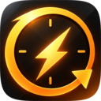
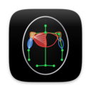
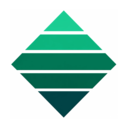

# Hey, I'm Dennis

Software engineering consultant and founder of [KITE Interactive](https://www.kite-interactive.online). I build across the stack with AI agents in the loop.

I combine solid engineering fundamentals with agent-driven workflows and pick the language for the problem, from Swift and Metal on the Mac to React, Node.js and Postgres on the web. Below is what I've been building.

## Projects

| | Project | Description |
|:-:|---|---|
|  | <b>🐦‍⬛ Crow</b> | Card scanner and price guide for Magic, Pokémon, Lorcana, One Piece and Yu-Gi-Oh! on iPhone, Android and web |
|  | <b>🪷 Noema</b> | Generative audiovisual studio with audio-reactive worlds and a synth lab for Apple, Android and Windows |
|  | <b>🧭 Claudetographer</b> | Live map of every Claude Code session, subagent, agent team and workflow, with cost and forecasts |
|  | <b>🔍 Loupe</b> | macOS menu bar tool that picks any UI element through the Accessibility API and hands it to your coding agent |
|  | <b>✍️ Jot</b> | macOS Markdown notepad with Claude ghost-text autocomplete, one-key rewrites and Obsidian vaults |
|  | <b>📸 fetch-screenshots</b> | Playwright CLI that crawls a site and saves full-page light and dark screenshots of every page |
|  | <b>📽️ Montage</b> | Remotion studio that renders icons, GIFs and explainer videos for every 0x1ad2 project from one config |
|  | <b>🖱️ Halo</b> | macOS cursor highlighter with 17 stackable Metal shader effects, custom cursors and a live shader studio |
|  | <b>🏠 Homey</b> | Local-first home control for iPhone, iPad and Mac that maps your LAN and drives WiZ lights and Denon receivers |
|  | <b>⚡ VoltWake</b> | High-energy alarms, smart wake-ups, timers and interval training for iPhone and Apple Watch with AlarmKit |
|  | <b>💪 Muscle Mirror</b> | macOS anatomical mirror that tracks your body with Apple Vision and draws 22 live muscle overlays |
|  | <b>🎛️ Wavr</b> | Loop-based music studio for Mac, iPhone and iPad to arrange, record, synthesize, mix, perform and export WAV |
|  | <b>⏱️ Tempo</b> | Kanban board and calendar time-blocking in one, with two-way sync against simulated Google Calendar and Tasks |
|  | <b>🃏 Card Ledger</b> | Private React dashboard for trading card purchases with ECharts spend charts and an AG Grid order ledger |
|  | <a href="https://www.kite-interactive.online"><b>🪁 KITE Interactive website</b></a> | KITE Interactive — company website told as a scroll-driven WebGPU film, with CRT shaders and page curls |
|  | <a href="https://www.0x1ad2.dev"><b>🌈 0x1ad2.dev</b></a> | 0x1ad2.dev — personal site and blog of Dennis Bruijn with WebGL heroes, live three.js demos and a new hue per visit |

## Stack

Swift · SwiftUI · Metal · Kotlin · C++ · Rust · Python · TypeScript · React · Node.js · PostgreSQL · Supabase · three.js · Vite

## Elsewhere

[0x1ad2.dev](https://www.0x1ad2.dev) · [KITE Interactive](https://www.kite-interactive.online) · [LinkedIn](https://www.linkedin.com/in/dbbruijn)

Building something and want a second pair of hands? [Say hi](https://www.0x1ad2.dev/contact).
