# Hey, I'm Dennis

Software engineering consultant and founder of [KITE Interactive](https://www.kite-interactive.online). I build across the stack with AI agents in the loop.

I combine solid engineering fundamentals with agent-driven workflows and pick the language for the problem, from Swift and Metal on the Mac to React, Node.js and Postgres on the web. Below is what I've been building.

## Featured

<table>
<tr>
<td width="50%" valign="top">

<b>🐦‍⬛ Crow</b> 
Card scanner and price guide for Magic, Pokémon, Lorcana, One Piece and Yu-Gi-Oh! on iPhone, Android and web
 

         

<a href="assets/crow/explainer.mp4">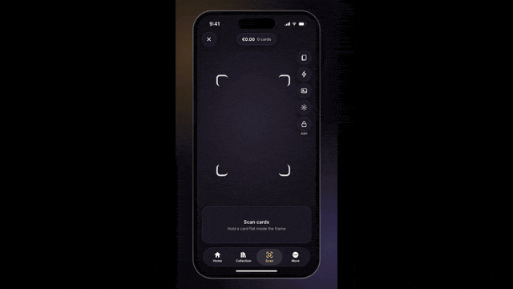</a>
 <a href="assets/crow/explainer.mp4">Watch the explainer</a> (mp4, 1.4 MB)
</td>
<td width="50%" valign="top">
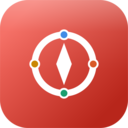
<b>🧭 Claudetographer</b> 
Live map of every Claude Code session, subagent, agent team and workflow, with cost and forecasts
 

         

<a href="assets/claudetographer/explainer.mp4">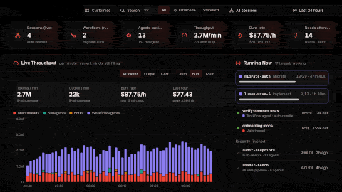</a>
 <a href="assets/claudetographer/explainer.mp4">Watch the explainer</a> (mp4, 1.4 MB)
</td>
</tr>
<tr>
<td width="50%" valign="top">
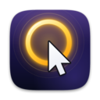
<b>🖱️ Halo</b> 
macOS cursor highlighter with 17 stackable Metal shader effects, custom cursors and a live shader studio
 

     

 <a href="assets/halo/explainer.mp4">Watch the explainer</a> (mp4, 1.3 MB)
</td>
<td width="50%" valign="top">

<b>🪷 Noema</b> 
Generative audiovisual studio with audio-reactive worlds and a synth lab for Apple, Android and Windows
 

           

<a href="assets/noema/explainer.mp4">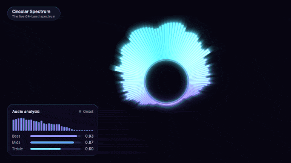</a>
 <a href="assets/noema/explainer.mp4">Watch the explainer</a> (mp4, 2.2 MB)
</td>
</tr>
<tr>
<td width="50%" valign="top">
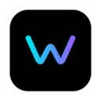
<b>🎛️ Wavr</b> 
Loop-based music studio for Mac, iPhone and iPad to arrange, record, synthesize, mix, perform and export WAV
 

      

<a href="assets/wavr/explainer.mp4">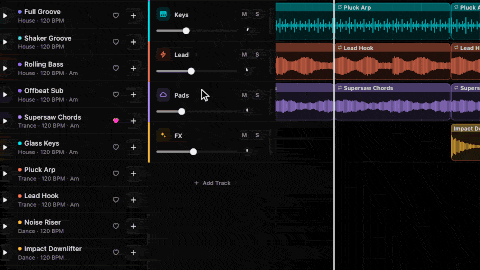</a>
 <a href="assets/wavr/explainer.mp4">Watch the explainer</a> (mp4, 2.2 MB)
</td>
<td width="50%" valign="top">
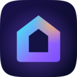
<b>🏠 Homey</b> 
Local-first home control for iPhone, iPad and Mac that maps your LAN and drives WiZ lights and Denon receivers
 

       

<a href="assets/homey/explainer.mp4">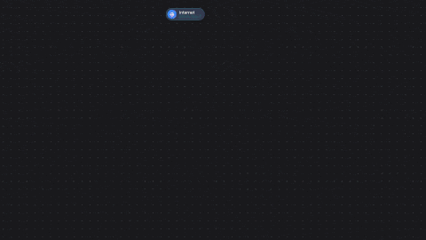</a>
 <a href="assets/homey/explainer.mp4">Watch the explainer</a> (mp4, 1.1 MB)
</td>
</tr>
</table>

## All projects

### Cross-platform products

| Icon | Project | What it is | Platforms | Status |
|:-:|---|---|---|---|
|  | <b>🐦‍⬛&nbsp;Crow</b> | Card scanner and price guide for Magic, Pokémon, Lorcana, One Piece and Yu-Gi-Oh! on iPhone, Android and web      <a href="assets/crow/explainer.mp4"><picture><source media="(prefers-color-scheme: light)" srcset="assets/crow/preview-light.webp">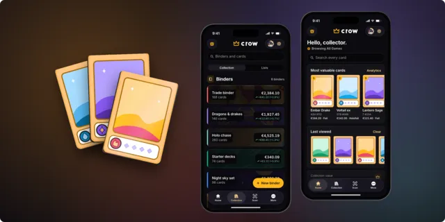</picture></a> <a href="assets/crow/explainer.mp4">Explainer</a> (1.4 MB) | iPhone and iPad (iOS and iPadOS 27+), Android 13+, web dashboard | v1.0.0 |
|  | <b>🪷&nbsp;Noema</b> | Generative audiovisual studio with audio-reactive worlds and a synth lab for Apple, Android and Windows      <a href="assets/noema/explainer.mp4"><picture><source media="(prefers-color-scheme: light)" srcset="assets/noema/preview-light.webp">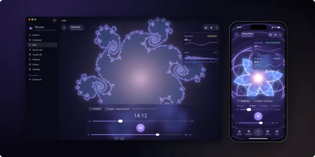</picture></a> <a href="assets/noema/explainer.mp4">Explainer</a> (2.2 MB) | iPhone, iPad, Mac, Apple Watch, Android, Windows | v1.0.1 |

### Agent and developer tools

| Icon | Project | What it is | Platforms | Status |
|:-:|---|---|---|---|
|  | <b>🧭&nbsp;Claudetographer</b> | Live map of every Claude Code session, subagent, agent team and workflow, with cost and forecasts      <a href="assets/claudetographer/explainer.mp4"><picture><source media="(prefers-color-scheme: light)" srcset="assets/claudetographer/preview-light.webp">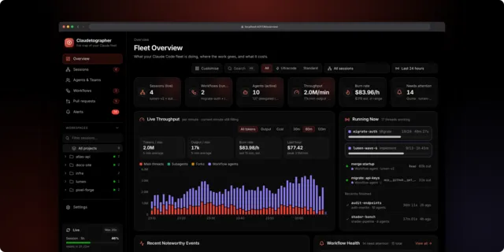</picture></a> <a href="assets/claudetographer/explainer.mp4">Explainer</a> (1.4 MB) | any OS with Node 23.6+, in the browser or VS Code's Simple Browser; macOS LaunchAgent for always-on | v2.4.0 |
| 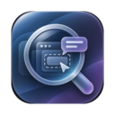 | <b>🔍&nbsp;Loupe</b> | macOS menu bar tool that picks any UI element through the Accessibility API and hands it to your coding agent     <a href="assets/loupe/explainer.mp4"><picture><source media="(prefers-color-scheme: light)" srcset="assets/loupe/preview-light.webp">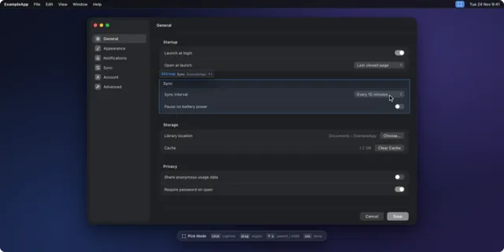</picture></a> <a href="assets/loupe/explainer.mp4">Explainer</a> (1.3 MB) | macOS 15+ (Liquid Glass on macOS 26) | In development |
|  | <b>✍️&nbsp;Jot</b> | macOS Markdown notepad with Claude ghost-text autocomplete, one-key rewrites and Obsidian vaults      <a href="assets/jot/explainer.mp4"><picture><source media="(prefers-color-scheme: light)" srcset="assets/jot/preview-light.webp">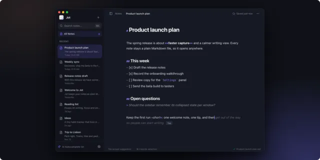</picture></a> <a href="assets/jot/explainer.mp4">Explainer</a> (1.2 MB) | macOS (JotMac needs macOS 14+) | In development |
| 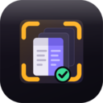 | <b>📸&nbsp;fetch-screenshots</b> | Playwright CLI that crawls a site and saves full-page light and dark screenshots of every page    <a href="assets/fetch-screenshots/explainer.mp4">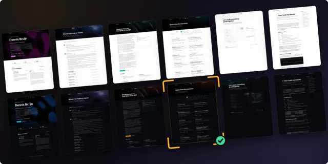</a> <a href="assets/fetch-screenshots/explainer.mp4">Explainer</a> (1.1 MB) | macOS, Linux, Windows | In development |
|  | <b>📽️&nbsp;Montage</b> | Remotion studio that renders icons, GIFs and explainer videos for every 0x1ad2 project from one config     <a href="assets/montage/explainer.mp4">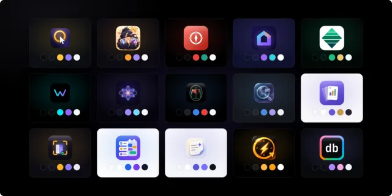</a> <a href="assets/montage/explainer.mp4">Explainer</a> (0.8 MB) | macOS or Linux, Node 23.6+ | In development |

### Apple apps

| Icon | Project | What it is | Platforms | Status |
|:-:|---|---|---|---|
|  | <b>🖱️&nbsp;Halo</b> | macOS cursor highlighter with 17 stackable Metal shader effects, custom cursors and a live shader studio     <a href="assets/halo/explainer.mp4">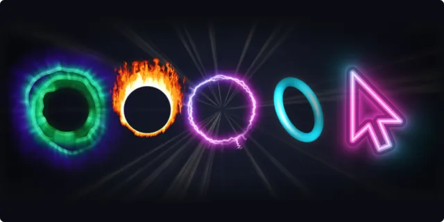</a> <a href="assets/halo/explainer.mp4">Explainer</a> (1.3 MB) | macOS 26+ | In development |
|  | <b>🏠&nbsp;Homey</b> | Local-first home control for iPhone, iPad and Mac that maps your LAN and drives WiZ lights and Denon receivers     <a href="assets/homey/explainer.mp4"><picture><source media="(prefers-color-scheme: light)" srcset="assets/homey/preview-light.webp">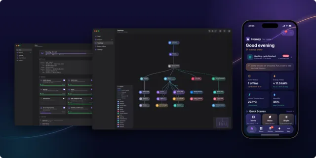</picture></a> <a href="assets/homey/explainer.mp4">Explainer</a> (1.1 MB) | iOS, iPadOS and macOS 26 | In development |
|  | <b>⚡&nbsp;VoltWake</b> | High-energy alarms, smart wake-ups, timers and interval training for iPhone and Apple Watch with AlarmKit      <a href="assets/voltwake/explainer.mp4"><picture><source media="(prefers-color-scheme: light)" srcset="assets/voltwake/preview-light.webp">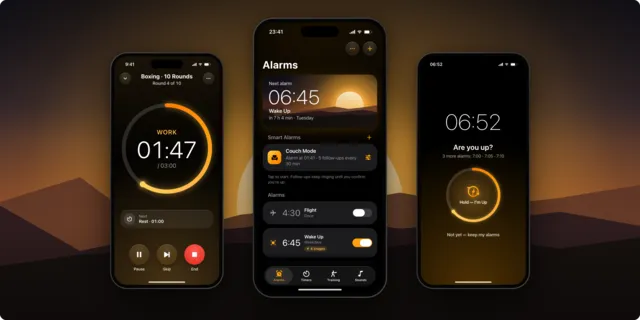</picture></a> <a href="assets/voltwake/explainer.mp4">Explainer</a> (1.0 MB) | iOS 26+, watchOS 26+ | In development |
|  | <b>💪&nbsp;Muscle Mirror</b> | macOS anatomical mirror that tracks your body with Apple Vision and draws 22 live muscle overlays    <a href="assets/muscle-mirror/explainer.mp4"><picture><source media="(prefers-color-scheme: light)" srcset="assets/muscle-mirror/preview-light.webp">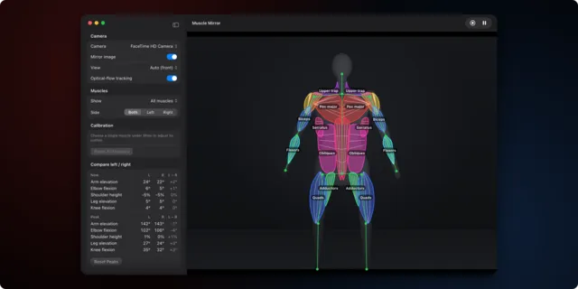</picture></a> <a href="assets/muscle-mirror/explainer.mp4">Explainer</a> (1.1 MB) | macOS 15+ | v1.0.0 |

### Creative audio and visual

| Icon | Project | What it is | Platforms | Status |
|:-:|---|---|---|---|
|  | <b>🎛️&nbsp;Wavr</b> | Loop-based music studio for Mac, iPhone and iPad to arrange, record, synthesize, mix, perform and export WAV    <a href="assets/wavr/explainer.mp4"><picture><source media="(prefers-color-scheme: light)" srcset="assets/wavr/preview-light.webp">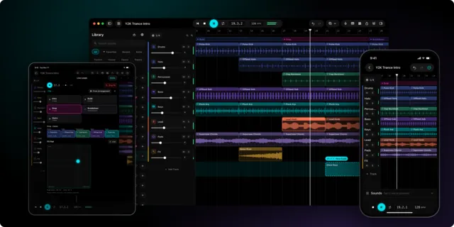</picture></a> <a href="assets/wavr/explainer.mp4">Explainer</a> (2.2 MB) | macOS 15+, iOS and iPadOS 18+ | v1.2.0 |

See also 🪷 Noema under [Cross-platform products](#cross-platform-products).

### Web apps

| Icon | Project | What it is | Platforms | Status |
|:-:|---|---|---|---|
|  | <b>⏱️&nbsp;Tempo</b> | Kanban board and calendar time-blocking in one, with two-way sync against simulated Google Calendar and Tasks     <a href="assets/tempo/explainer.mp4"><picture><source media="(prefers-color-scheme: light)" srcset="assets/tempo/preview-light.webp">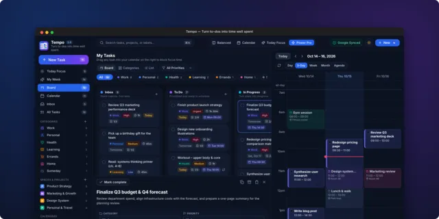</picture></a> <a href="assets/tempo/explainer.mp4">Explainer</a> (1.3 MB) | web; macOS 13+ wrapper app | In development |
| 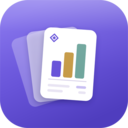 | <b>🃏&nbsp;Card Ledger</b> | Private React dashboard for trading card purchases with ECharts spend charts and an AG Grid order ledger     <a href="assets/card-ledger/explainer.mp4"><picture><source media="(prefers-color-scheme: light)" srcset="assets/card-ledger/preview-light.webp">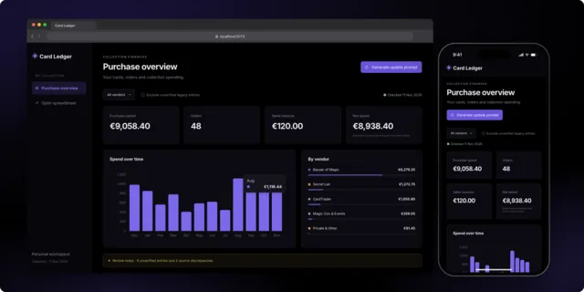</picture></a> <a href="assets/card-ledger/explainer.mp4">Explainer</a> (1.3 MB) | web (static, no backend) | In development |

### Sites

| Icon | Project | What it is | Platforms | Status |
|:-:|---|---|---|---|
|  | <a href="https://www.kite-interactive.online"><b>🪁&nbsp;KITE Interactive website</b></a> | KITE Interactive — company website told as a scroll-driven WebGPU film, with CRT shaders and page curls     <a href="assets/kite-website/explainer.mp4">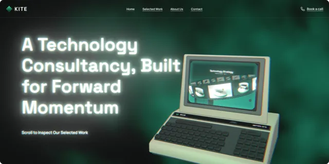</a> <a href="assets/kite-website/explainer.mp4">Explainer</a> (4.1 MB) | web | <a href="https://www.kite-interactive.online">Live site</a> |
| 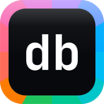 | <a href="https://www.0x1ad2.dev"><b>🌈&nbsp;0x1ad2.dev</b></a> | 0x1ad2.dev — personal site and blog of Dennis Bruijn with WebGL heroes, live three.js demos and a new hue per visit     <a href="https://www.0x1ad2.dev"><picture><source media="(prefers-color-scheme: light)" srcset="assets/0x1ad2-dev/preview-light.webp">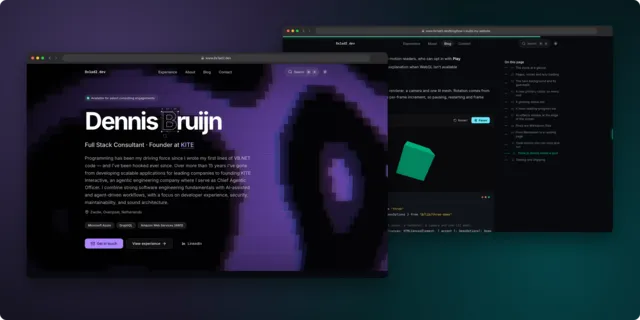</picture></a> | web | <a href="https://www.0x1ad2.dev">Live site</a> |

> Source is private. Access can be granted to anyone interested in contributing; [get in touch](https://www.0x1ad2.dev/contact).

Icons, GIFs and explainers are rendered with 📽️ Montage. Some product screens are mockups rebuilt from each app's source; each repo's media manifest says which.

## Stack

Swift · SwiftUI · Metal · Kotlin · C++ · Rust · Python · TypeScript · React · Node.js · PostgreSQL · Supabase · three.js · Vite

## Elsewhere

[0x1ad2.dev](https://www.0x1ad2.dev) · [KITE Interactive](https://www.kite-interactive.online) · [LinkedIn](https://www.linkedin.com/in/dbbruijn)

Building something and want a second pair of hands? [Say hi](https://www.0x1ad2.dev/contact).
